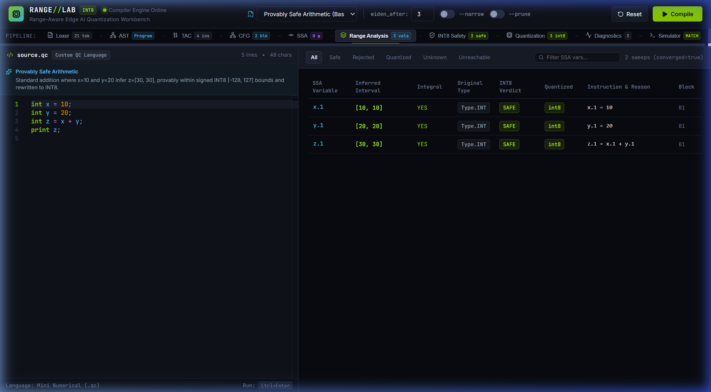
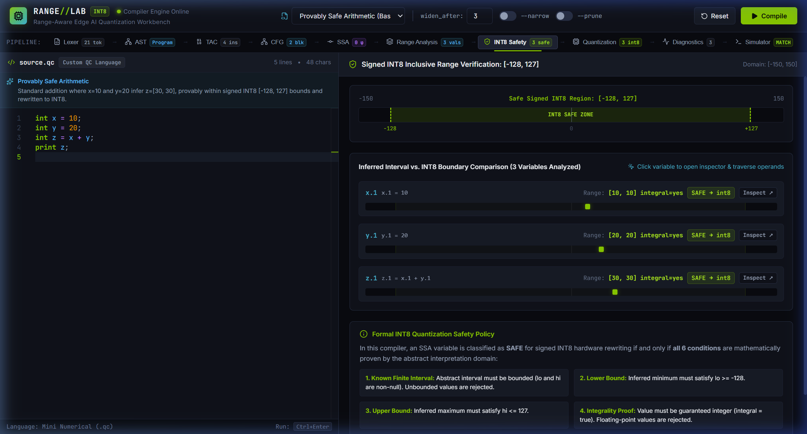
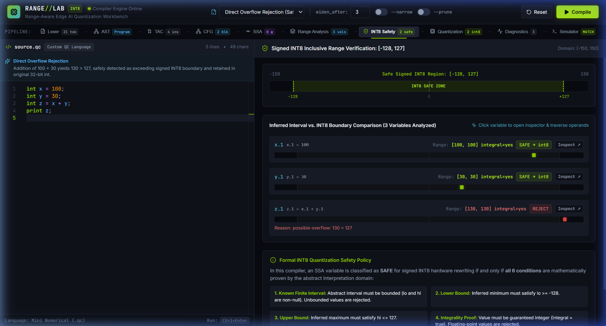
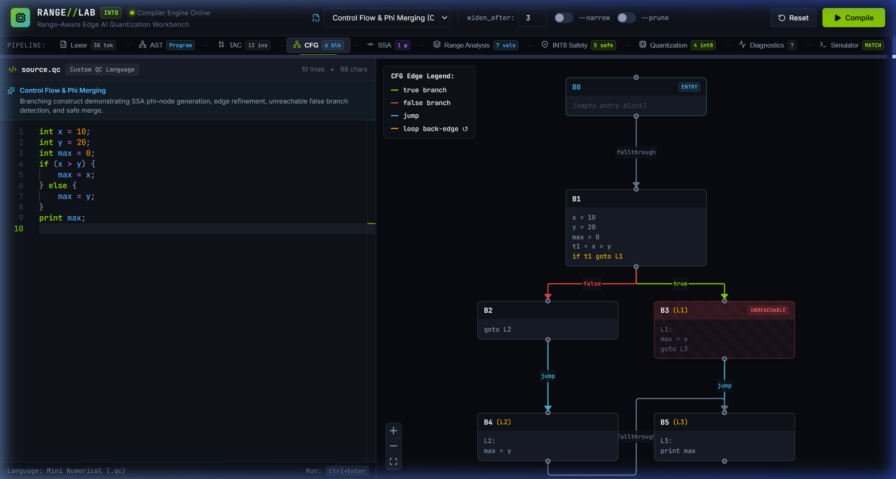
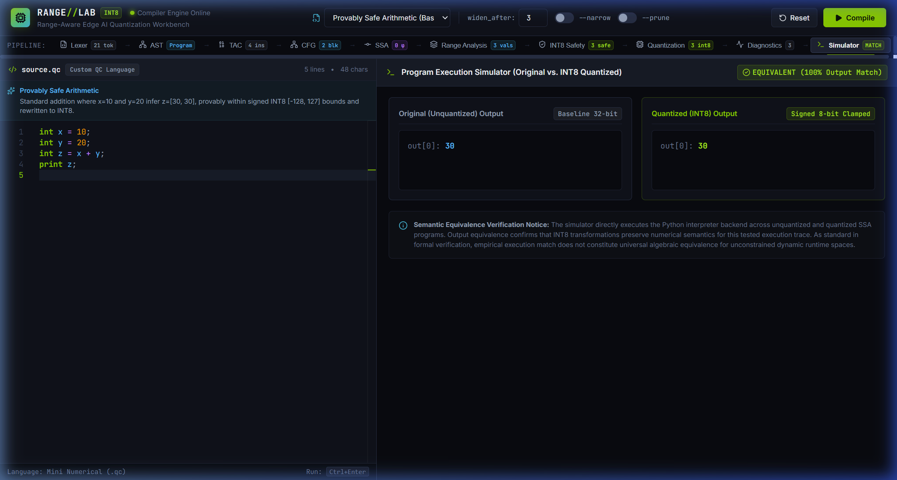
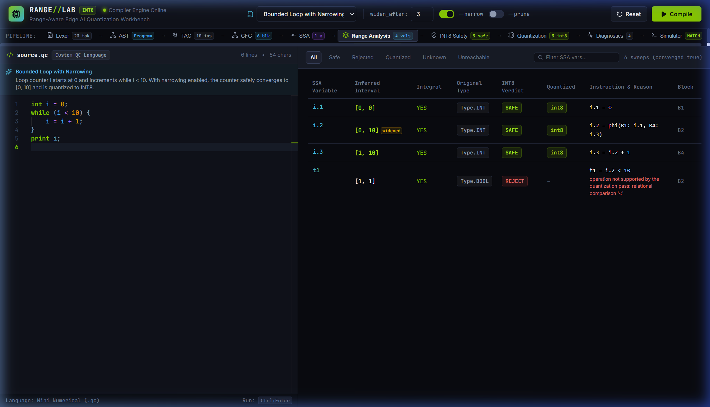
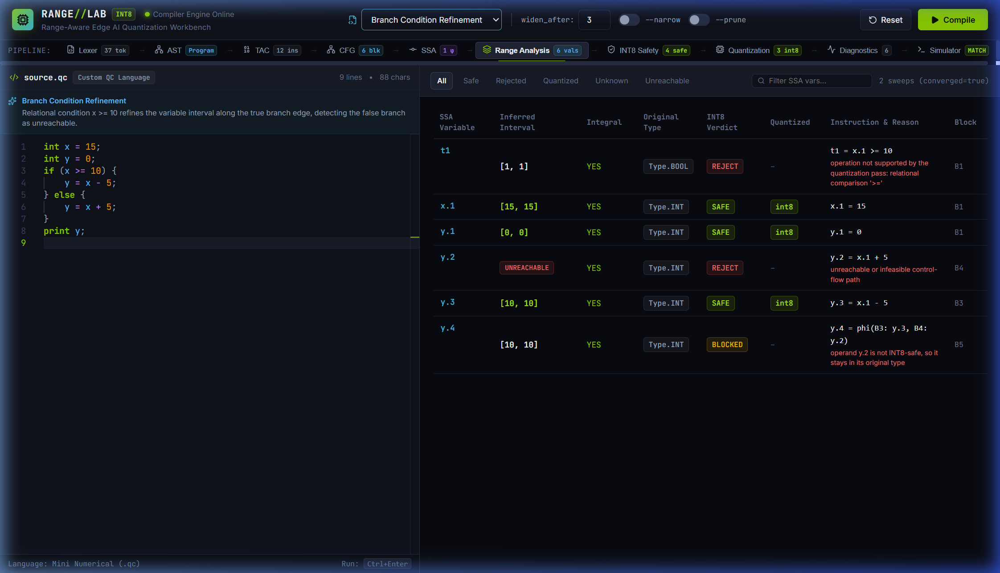
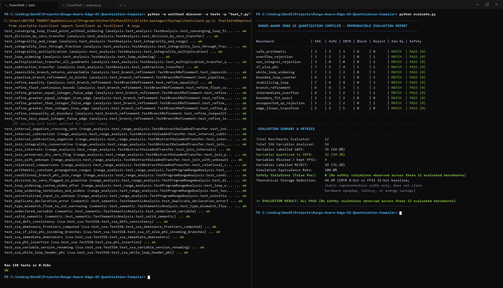

# RANGE//LAB — Complete Application Screenshot Evidence (14 Views)

Comprehensive visual gallery of verified high-resolution application screenshots captured directly from the live **RANGE//LAB — INT8 Quantization Workbench** compiler pipeline.

---

## Part 1: Core Workbench & Quantization Safety (Views 01–08)

### 01 — Main Workbench Interface
Complete RANGE//LAB desktop interface showing the source editor, compiler pipeline navigation, stage badges, and results panel.

---

### 02 — INT8 Safety & Range Analysis
Safe arithmetic evaluation with inferred value intervals mapped against the signed INT8 boundary `[-128, 127]`.

---

### 03 — Direct Overflow Rejection
Compilation of `overflow_rejection.qc` showing intermediate calculation `z.1 = x.1 + y.1` reaching `[130, 130] > 127`, triggering sound rejection with `REJECT` status.

---

### 04 — Interactive SSA Variable Inspector (`z.1`)
Clicking `z.1` in the comparison table opens the SSA Variable Inspector drawer displaying defining instruction `z.1 = x.1 + y.1`, inferred interval `[30, 30]`, operands, and INT8 verdict `SAFE`.

---

### 05 — In-Place Operand Traversal (`x.1`)
Clicking operand link `x.1` inside the drawer updates the inspector in-place to show definition `x.1 = 10`, interval `[10, 10]`, and downstream uses.

---

### 06 — Control-Flow Graph (CFG)
Interactive React Flow graph with basic blocks (`B0`, `B1`, `B2`, `B3`), conditional branch splits (True/False edges), and join blocks.

---

### 07 — Dual-Engine Simulator Equivalence
Side-by-side execution of original IR (FP32/INT) versus INT8 quantized IR verifying exact arithmetic equivalence `SIMULATION EQUIVALENT (MATCH)`.

---

### 08 — Bounded Loop Analysis with Sound Narrowing
Compilation of `bounded_loop_counter.qc` with `--narrow` enabled, showing loop counter `i` safely converging to bounded interval `[0, 10]`.

---

## Part 2: Compiler Pipeline Stages, IR Analysis & Verification (Views 09–14)

### 09 — Lexer Token Stream & Hierarchical AST
Frontend syntax analysis displaying the hierarchical Abstract Syntax Tree (`Program`, `Declaration`, `BinaryExpr`, `Identifier`, `IntLiteral`) with source line/column positions alongside the token stream stage indicator.

---

### 10 — TAC & SSA Intermediate Representation with φ-Nodes
Three-Address Code and SSA conversion with explicit φ-node resolution for conditional branching (`max.2 = phi(B1: max.1, B2: max.0)`), showing incoming values mapped to their control-flow predecessor blocks.

---

### 11 — Range Analysis Table & Convergence Metrics
Full static range analysis view showing variable intervals, integrality flags (`integral=yes`), safety status, filter pills, search filtering, and Kleene iteration sweep convergence (`converged=true`).

---

### 12 — Branch Condition Refinement & Unreachable Path Detection
Path-sensitive interval refinement along branch edges. The condition `x >= 10` refines variable intervals along the True branch (`[10, 10]`), while statically proving the False branch is contradictory and marking `y.2` as `UNREACHABLE`.

---

### 13 — Quantized IR Side-by-Side Diff & Intermediate Blocking
Side-by-side comparison of pre-quantization SSA IR against INT8 retyped IR. Demonstrates genuine INT8 rewriting (`a.1: int8`, `b.1: int8`), direct overflow rejection (`c.1: 150 > 127`), and intermediate dependency blocking (`d.1` blocked due to unsafe operand `c.1`).

---

### 14 — Automated Verification Suite & Reproducible Evaluation
Real terminal execution of the compiler test suite and reproducible benchmarks:
- **Unit Tests (`unittest`):** 137 / 137 tests passing (100% pass rate in 0.511s).
- **Reproducible Evaluation (`evaluate.py`):** 12 benchmarks evaluated, 54 SSA variables analyzed, 0 safety violations, 100% simulation equivalence rate (`ALL PASS`).

